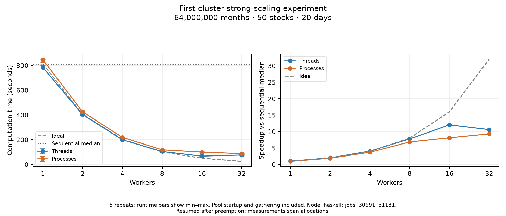

# OSPC: portfolio drawdowns and parallel simulation

## Repository guide

| Folder | Purpose |
|---|---|
| [calculations/](calculations/) | Main calculation, checks/ and jobs/. Run Python modules from the repository root. |
| [results/](results/) | Start here for plain-English experiment guides and the main graph. |
| [docs/](docs/) | Meeting guide, task status, validation/reproduction reports and project history. |
| [archive/](archive/) | Earlier preparation, preliminary experiment and recovery tools. |

**Main graph:** [results/strong_scaling/figures/strong_scaling.png](results/strong_scaling/figures/strong_scaling.png).
**Migration/provenance:** [docs/REPOSITORY_MAP.md](docs/REPOSITORY_MAP.md).
Future Slurm jobs must be submitted from the repository root, for example `sbatch calculations/jobs/full_scaling.slurm`. New runs use job-ID subfolders within their purpose folder. Read saved historical commands in older reports alongside the migration map.

**Progress review: 17 November 2026.** Start with the [meeting guide](docs/PROGRESS_REVIEW.md), the [full-size graph](results/strong_scaling/figures/strong_scaling.png), and the [results table](results/strong_scaling/measurements/scaling_summary.csv).

## The question

We simulate EUR 100,000 initially split equally across 50 fictional stocks and held for 20 trading days. For each possible month, we calculate maximum drawdown: the largest percentage fall from an earlier portfolio high. A portfolio rising from EUR 100,000 to EUR 110,000 and then falling to EUR 77,000 has a 30% drawdown, whatever its final value.

We examine the 99th-percentile drawdown threshold, the average of the largest 1% of drawdowns, and the frequency of drawdowns above 20%. The intended financial comparison is between constant normal conditions and a model that can enter persistent crisis conditions with higher volatility, stronger correlations and more negative mean log returns. Inputs are illustrative assumptions, not historical calibration or real crash forecasts.

The original one-day normal VaR problem has an analytical answer. Monthly maximum drawdown depends on the daily path. We retained the simple one-day arithmetic-normal model as a separate known-answer test; [that validation is completed](docs/NORMAL_VALIDATION.md). Specific professor feedback on the revised drawdown question is still needed.

## Completed work

| Work | Evidence and result |
|---|---|
| Small correctness checks | Hand-calculated paths, controlled cases and output checks; see [reproduction outputs](results/teammate_reproduction). |
| Parallel equivalence | Both models match sequential outputs in small thread/process checks. Every timed full-size crisis result also matched its reference. |
| Independent reproduction — Mia | [REPRODUCTION.md](docs/REPRODUCTION.md): checks, small demo and preliminary graph rebuilt in another account from a GitHub ZIP. |
| Analytical normal reference — Leo | [NORMAL_VALIDATION.md](docs/NORMAL_VALIDATION.md): three seeds, one million scenarios each; all VaR/ES comparisons within the stated 1% tolerance. This is not an analytical validation of monthly drawdown. |
| One-CPU qualification | [Job 30375](results/one_cpu_baseline): 64 million months, 799.94 s computation on one pinned logical CPU, peak RSS about 1.77 GiB. |
| Full-size strong scaling | [Results](results/strong_scaling): 65 validated measurements; 13 configurations, five repetitions each. Completed across jobs 30691 and 31181. |

## Main performance result

The same **64 million possible months, 50 stocks and 20 days** are calculated sequentially, with threads, and with processes. Pool worker counts are 1, 2, 4, 8, 16 and 32. This is **strong scaling**: fixed total work, increasing workers. The graph uses the **crisis model only**; blue/orange distinguish execution methods, not financial models.

| Configuration | Median seconds | Speedup vs sequential |
|---|---:|---:|
| Sequential | 810.94 | 1.00x |
| 8 threads | 104.47 | 7.76x |
| **16 threads** | **67.34** | **12.04x** |
| 32 threads | 76.55 | 10.59x |
| 16 processes | 99.97 | 8.11x |
| 32 processes | 87.16 | 9.30x |

Each point is the median of five runs; runtime bars show min–max. The fastest tested configuration was 16 threads. At full size, threads became slower from 16 to 32 workers; processes continued improving. Causes remain to be measured with profiling and overhead experiments.

**Measurement limitation:** Slurm preempted job 30691 after 25 measurements. Job 31181 completed the remaining 40 on the same node, haskell, in another allocation. The original measurements, new job IDs and both affinity lists are preserved. This is a completed resumed experiment, not an uninterrupted single-allocation experiment. Ask whether a clean single-allocation rerun is required for final assessment.

Fixed batches of 4,096 use SeedSequence.spawn streams assigned to batch IDs. All 65 full-size output digests match. Timings include allocation, seeds, pool lifecycle, simulation and gathering; validation, financial summaries and disk output are excluded. BLAS/OpenMP thread limits are 1. Five timing repetitions reuse the same scenarios and measure runtime variation, not financial sampling uncertainty. There are 65 timed calculations plus reference checks, which explains the several-hour experiment duration.

## Where the results are

| Folder | Purpose |
|---|---|
| [full-scaling-30691](results/strong_scaling) | **Main full-size performance result:** raw timings, metadata, summary, PNG/PDF and the pre-resumption backup. The original folder name was retained when job 31181 continued it. |
| [full-baseline-30375](results/one_cpu_baseline) | One-CPU runtime/memory evidence and full-size crisis financial summary. |
| [scaling-30338](archive/preliminary_scaling) | Preliminary 2,097,152-month experiment, retained as earlier evidence. |
| [normal-validation-30985](results/mathematical_check) | Separate mathematical reference test and cluster evidence. |
| [reproduction](results/teammate_reproduction) | Another account's correctness and demo outputs. |

In the main experiment folder, timings.csv holds all 65 measurements; scaling_summary.csv holds the 13 summaries; metadata.json records settings and allocations. To redraw the graph without simulating again:

~~~bash
python -m calculations.plot_scaling results/strong_scaling
~~~

## Code and tools

| Files/tool | Role |
|---|---|
| simulate.py / parallel.py | Financial calculation; sequential and thread/process execution. |
| check.py / check_parallel.py / validate_normal.py | Controlled correctness, equivalence and known-answer checks. |
| benchmark.py / plot_scaling.py | Repeated timings and graphs from saved measurements. |
| full_baseline.py and .slurm files | Baseline verification and cluster job instructions. |
| resume_scaling.py / resume_scaling.slurm | Recovery of missing measurements after preemption. |
| profile_baseline.slurm / normal_comparison.slurm | Provided scripts for remaining profiling and financial-comparison tasks; completed evidence not yet uploaded at this review. |
| calibrate.py / produce.py | Earlier workload-preparation helpers. |
| JupyterLab / Slurm / GitHub | Cluster workspace / job scheduler / shared versioned source and evidence. |

See [PROJECT_LOG.md](docs/PROJECT_LOG.md) for history and [TEAM_TASKS.md](docs/TEAM_TASKS.md) for task status and commands.

## Run a small example

Accept the private repository invitation and use your own cluster account. With Git authentication configured:

~~~bash
cd ~
git clone https://github.com/dmainardieu2024/ospc_project.git
cd ospc_project
export PATH=/data/software/envs/ospc/bin:$PATH
export OMP_NUM_THREADS=1
export OPENBLAS_NUM_THREADS=1
export MKL_NUM_THREADS=1
python -m calculations.checks.check
python -m calculations.checks.check_parallel
python -m calculations.simulate --scenarios 1000 --batch-size 4096 --output results/my-demo
~~~

For an existing clone, save/commit local work and integrate upstream changes before running updated code. A GitHub ZIP is an alternative snapshot; extract it with unzip in the terminal. Double-clicking a ZIP as text in JupyterLab can produce a harmless UTF-8 error. Use a fresh output folder to preserve earlier results. Never share credentials or tokens.

The verified cluster environment was Python 3.12.15 and NumPy 2.5.4; Matplotlib is needed for plots. Record actual versions. The full environment is not yet pinned or verified by a fresh-clone test. Large .npy scenario arrays are excluded from Git. Push small evidence files so teammates can access them; another cluster account cannot automatically see your home folder. The old final message in check.py predates the completed parallel and analytical checks; consult the dedicated checks and reports for their current status.

## Remaining work

- Upload completed profiling evidence, identify bottlenecks and compare measured/inferred serial fractions with Amdahl's model.
- Complete and document the full-size normal/crisis financial comparison. The saved full-size crisis summary alone gives a 15.40% drawdown threshold and a 19.19% mean in the worst 1%; a matching full-size normal result is still needed.
- Measure overhead, implement/compare multiprocessing.shared_memory, and run weak scaling.
- Quantify sampling uncertainty across independent seeds and assess parameter sensitivity.
- Obtain feedback on the revised question and the interrupted-allocation limitation.
- Prepare final report/presentation, fresh-clone reproducibility and syllabus-format AI acknowledgement. AI-assisted code and explanations have been used.

These are progress-review results; completion of the performance experiment does not mean the final project is finished.
