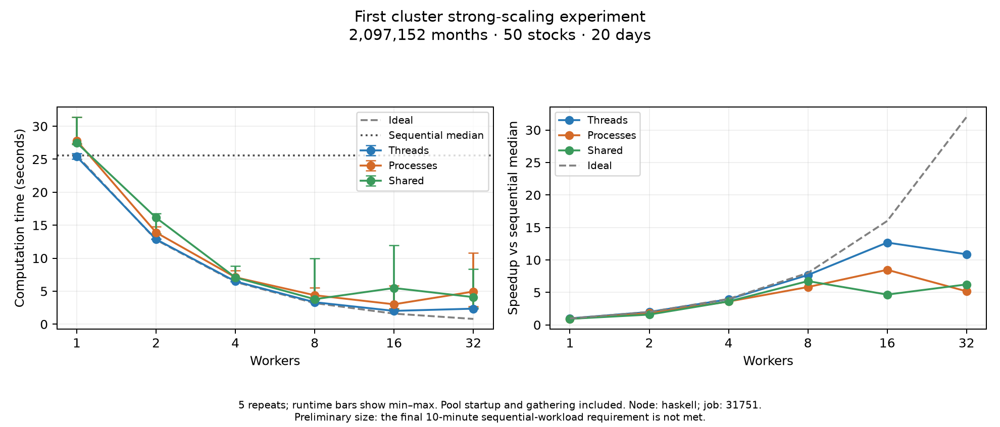

## 1. Question

In his feedback on our original proposal, the professor asked us to use
`multiprocessing.shared_memory` (recorded in `PROJECT_LOG.md`, entry "15 November 2026 —
agreed question and scope"). This document describes how we added it as a third way of
running the simulation, next to threads and processes, and what we found.

In the process pool, every worker simulates a batch of 4,096 months and returns three
arrays to the parent: maximum drawdowns, final portfolio values and crisis days.
Processes do not share memory, so Python pickles these arrays, sends them through a pipe
and the parent copies them into its own arrays. Threads avoid this: they run inside one
process and see the same memory. At full size this transfer happens 15,625 times
(64,000,000 ÷ 4,096), about 96 KB each time, so roughly 1.5 GB in total.

The full-size scaling experiment (jobs 30691 and 31181) showed processes slower than
threads: 99.97 s against 67.34 s with 16 workers. Our question is: **how much of that
gap comes from sending results back to the parent?** With shared memory, workers write
their results directly into arrays the parent can read, so this transfer disappears. If
it were the main cause of the gap, removing it should close most of it.

Lecture 15 measured that sending an 80 MB NumPy array to a process took 117 ms. At that
rate, 1.5 GB takes about 2 s, far less than the 33 s gap, so we expected shared memory
to close only a small part of it. The experiment tests that expectation.


## 2. Design

The new method lives in `calculations/parallel_shm.py` (function `compute_shared`). It
reuses the financial model unchanged: `simulate.py` was not modified, and every batch
gets the same size and the same `SeedSequence` child as in the sequential, thread and
process versions. Only the way results reach the parent changes.

| | Process pool (`parallel.py`) | Shared-memory pool (`parallel_shm.py`) |
|---|---|---|
| Where the three result arrays live | in the parent's private memory | in three `SharedMemory` blocks the parent creates |
| What a worker returns per batch | three arrays (~96 KB), pickled through a pipe | nothing (only batch 0 returns 5 example paths) |
| Who writes the results | the parent copies each batch into its arrays | each worker writes its batch directly into its slice |

How it works:

1. **The parent creates three shared blocks**, one per output: drawdowns (float64),
   final values (float64) and crisis days (int32), each with one slot per month. At full
   size that is 1.28 GB in total.
2. **Each worker attaches once.** The pool's `initializer` opens the three blocks by
   name when the worker starts and wraps them as NumPy arrays, instead of reopening them
   for each of the 15,625 batches. Workers are started with `spawn`, as in `parallel.py`.
3. **Each worker writes only its own slice** `[start:stop]` of each array. Batches never
   overlap, so no two workers write the same memory and no locks are needed.
4. **The parent copies the results out and cleans up.** After the pool finishes, the
   parent copies the three arrays into ordinary NumPy arrays, then closes and unlinks
   the blocks inside a `finally` clause. Only the parent unlinks, and the `finally`
   makes sure the blocks are removed from `/dev/shm` even if something fails.

**Timing boundary.** The measured time runs from creating the blocks to after they are
unlinked: block creation, seeds, pool start and stop, simulation, copying out and
cleanup. It therefore includes every cost that shared memory adds, not only the costs
it removes. The copy-out exists only because of this design, and we time it rather than
leave it out. The process pool's boundary is the same except for the shared-memory
steps.


## 3. Correctness

Shared memory changes how results travel, so the first requirement is that it does not
change the results. We checked this at three levels.

**1. Equivalence and cleanup check** (`calculations/checks/check_shared.py`). On a small
problem (1,031 months in batches of 128, so 9 batches including a partial last one;
7 assets; 20 days; seed 20261115), the check runs the sequential `compute` and
`compute_shared` with 1 and 2 workers, for both the normal and the crisis model, and
requires:
- every output to be exactly equal (drawdowns, final values, crisis days and example
  paths), and the combined result digest to be byte-identical;
- exactly three shared-memory blocks to be created per run, and each of them to be gone
  afterwards. The check records the names of the blocks *it* creates, so other users'
  blocks in the node's shared `/dev/shm` cannot affect it, and it stops with an error if
  any block remains.

Result: 4/4 PASS (`results/shared_memory/check_outputs/check_shared.txt`). We also
confirmed that the check can fail: with `block.unlink()` removed, it stops with
`AssertionError: Shared-memory block ... was not removed`.

**2. Every timed run is checked.** `benchmark.py` compares the digest of every timed
result with a sequential reference computed at the start of the job, and stops if any
run differs. In job 31751 on haskell (2,097,152 months, 1 to 32 workers), all 95 timed
runs were correct, including all 30 shared-memory runs. The job script runs
`check_shared` before timing anything and stops on any error, so the job completing also
means the check passed on haskell.

**3. Local preview.** Before submitting the job, a small benchmark in the interactive
2-CPU session (65,536 months, 1 and 2 workers) gave 25/25 correct runs
(`results/shared_memory/check_outputs/benchmark_preview.txt`). This tests the pipeline
only; its timings are not measurements.

**Record of a mistake.** Commit `ca093b2` saved check outputs that had failed because
the course Python environment was not loaded in the terminal (NumPy not found). Commit
`b4509f2` replaces them with outputs from a correctly loaded environment.

**Limits.** The small check uses 1 and 2 workers because the interactive session has
2 CPUs; larger worker counts are covered by the benchmark's per-run check in job 31751.
Correctness at the full 64-million-month size has not yet been tested for shared memory.


## 4. Experiment

**Job 31751**, submitted on 17 November 2026 from `calculations/jobs/shared_scaling.slurm`.
State `COMPLETED`, exit code `0:0`, elapsed 19 min 30 s.

| Setting | Value |
|---|---|
| Node | haskell (the node of all earlier scaling results) |
| Resources | 64 logical CPUs (2 per worker at 32 workers), 16 GB |
| Workload | crisis model, 2,097,152 months, 50 stocks, 20 days |
| Batches | 512 batches of 4,096 months, seed 20261115 |
| Methods | sequential, threads, processes, shared memory |
| Workers | 1, 2, 4, 8, 16, 32 |
| Repeats | 5 per configuration; configuration order shuffled in each repeat |
| Library threads | `OMP_NUM_THREADS`, `OPENBLAS_NUM_THREADS`, `MKL_NUM_THREADS` = 1 |
| Environment | Python 3.12.15, NumPy 2.5.4 |
| Code version | commit `6f55d60` (source fingerprints in `run_details/metadata.json`) |

All four methods ran in the same job, so they share the node, the CPUs and the period of
time. Before timing, the job runs one unreported sequential calculation that provides
the correctness reference. Speedup is measured against the median of the five
sequential runs in this same job.

**Size.** This is the preliminary size used in the first scaling experiment (job 30338,
`archive/preliminary_scaling/`), chosen so the job finishes in about 20 minutes and can
be compared with it. The sequential median, 25.57 s, does not meet the 10-minute
workload requirement, so this run does not replace the 64-million-month experiment. A
full-size shared-memory run is planned (Section 7).

**Timing boundary in this job.** Job 31751 ran the version of `compute_shared` in which
the timer stopped *before* the blocks were closed and unlinked. Section 2 describes the
current version, which also times the cleanup (changed after review). At this size the
cleanup frees about 42 MB and should take milliseconds, but this job's shared-memory
times do not include it.

Files: `results/shared_memory/job-31751/`: `measurements/timings.csv` (all 95 runs, with
node load at the start and end of each), `measurements/scaling_summary.csv`,
`figures/strong_scaling.png`, `run_details/metadata.json` and the Slurm log
`run_details/shared-scaling-31751.out`.


## 5. Results



*The figure's title reads "First cluster strong-scaling experiment" because that text is
fixed in `plot_scaling.py`; this figure belongs to job 31751.*

**Computation time in seconds: median of 5 runs (minimum–maximum).** Sequential median:
25.57 s (25.19–25.85).

| Workers | Threads | Processes | Shared memory |
|---:|---|---|---|
| 1 | 25.39 (25.02–25.88) | 27.81 (27.41–31.40) | 27.49 (27.23–31.38) |
| 2 | 12.86 (12.85–12.93) | 13.90 (13.72–14.80) | 16.13 (13.75–16.80) |
| 4 | 6.49 (6.44–6.50) | 7.11 (7.02–8.13) | 7.08 (6.98–8.85) |
| 8 | 3.33 (3.31–3.35) | 4.39 (3.77–5.56) | 3.79 (3.68–9.99) |
| 16 | 2.02 (2.00–2.09) | 3.02 (2.43–5.83) | 5.48 (2.24–11.96) |
| 32 | 2.35 (2.34–2.45) | 4.95 (2.70–10.78) | 4.10 (2.43–8.37) |

**Speedup against the sequential median** (computed from medians):

| Workers | 1 | 2 | 4 | 8 | 16 | 32 |
|---|---:|---:|---:|---:|---:|---:|
| Threads | 1.01 | 1.99 | 3.94 | 7.68 | 12.67 | 10.87 |
| Processes | 0.92 | 1.84 | 3.60 | 5.83 | 8.48 | 5.17 |
| Shared memory | 0.93 | 1.59 | 3.61 | 6.74 | 4.67 | 6.23 |

**What the measurements show:**
- All 95 timed runs produced results identical to the sequential reference.
- **Threads were stable:** at every worker count the slowest run was at most 5% slower
  than the fastest.
- **Processes and shared memory were not:** from 8 workers on, the slowest run took up
  to 4.0 times (processes, 32 workers) and 5.3 times (shared memory, 16 workers) as long
  as the fastest run of the same configuration.
- **Fastest runs** at 16 workers: threads 2.00 s, shared memory 2.24 s, processes
  2.43 s. At 32 workers: threads 2.34 s, shared memory 2.43 s, processes 2.70 s.
- **Compared with job 30338** (same size and node, 15 November), threads gave similar
  medians (16 workers: 2.02 s now, 1.91 s then). Processes were slower and more
  variable now: at 16 workers 3.02 s (2.43–5.83) against 2.45 s (2.32–3.30) then; at
  32 workers 4.95 s (2.70–10.78) against 2.55 s (2.43–2.74).
- During the runs at 16 and 32 workers, the node's one-minute load average ranged from
  about 3 to 11.


## 6. Interpretation and limitations

**1. The medians cannot tell us whether shared memory beats plain processes.** For 8,
16 and 32 workers, the two methods' minimum–maximum ranges overlap almost completely,
and the difference between their medians changes sign (16 workers: shared memory 5.48 s
against 3.02 s; 32 workers: 4.10 s against 4.95 s). With spreads of several seconds and
only five runs, these medians mostly reflect which runs happened to be slow. The same
applies to their speedup curves, so the dip of shared memory at 16 workers should not be
read as shared memory being slower. The data show no consistent difference in either
direction.

**2. The fastest runs suggest shared memory removes part of the extra cost of processes.**
At 16 workers the fastest process run was 0.43 s slower than the fastest thread run;
shared memory reduced that difference to 0.24 s. At 32 workers it went from 0.36 s to
0.09 s. This is consistent with result transfer being one of the costs that make
processes slower than threads. It is only an indication: each value is the single
fastest of five runs, which is an optimistic statistic. The improvement is also larger
than the transfer alone would predict. At this size, workers send back about 50 MB in
total, which at Lecture 15's measured rate takes about 0.07 s. A possible reason is that
the parent receives and copies the 512 results one at a time, which shared memory also
removes; we have not measured this.

**3. The variability only affects methods that start new processes.** Threads ran in the
same job, on the same CPUs, interleaved in random order with the other methods, and
stayed within 5%. So the slow runs were not a general slowdown of the node. The load
average (about 3 to 11) was low for a node with 256 cores, so other users' computing
does not obviously explain it either, although a one-minute average can miss short
events. What processes and shared memory have in common, and threads lack, is that
every run starts 1 to 32 new Python interpreters (`spawn`), each of which imports
Python and NumPy from the shared `/data/software` filesystem. Our leading hypothesis is
that **process start-up time varies strongly**; others include memory allocation in
many separate processes. None of these is measured yet. Job 30338 (15 November) showed
much less variability for processes, so the effect seems to depend on conditions at the
time of the run.

**4. Our prediction is not yet tested.** Section 1 predicted that shared memory would
close only a small part of the 33 s gap between processes and threads at full size. At
this preliminary size the gap is about 1 s at the median and 0.4 s between fastest runs,
while the run-to-run variation is several seconds, so this job can neither confirm nor
reject it.

**What we can conclude:**
- The shared-memory version is correct and works at every worker count up to 32.
- There is an indication, not a result, that it removes part of the overhead of
  processes.
- At this size, the main obstacle to process scaling in this run was variability, not
  result transfer.

**Limitations:**
- Preliminary size: 2,097,152 months; the sequential run takes 25.6 s, below the
  10-minute requirement. The 33 s full-size gap was not tested.
- Five repeats are too few when single runs can be five times slower; medians and
  speedups are sensitive to them.
- One job, on one afternoon: the variability may differ at other times.
- The timing boundary excluded shared-memory cleanup (Section 4), probably milliseconds
  at this size.
- Neither result transfer nor process start-up was measured directly; their roles are
  inferred.


## 7. Next steps

1. **Measure process start-up directly.** A short script (`calculations/overhead.py`)
   that, for 1 to 32 workers and 10 repeats, times starting a `spawn` pool until every
   worker is running, and shutting it down, run as its own Slurm job on haskell. If
   start-up time varies by seconds, it explains most of the variability in Section 6. It
   also gives the direct overhead measurement that Lecture 16 requires.
2. **Measure result transfer directly:** the time for a worker to return one batch
   (~96 KB) against returning nothing. This tests whether transfer, or the parent's
   handling of results, explains the 0.2–0.3 s seen between the fastest runs.
3. **Repeat the comparison** with the current timing boundary (cleanup included) and
   more repeats, to see whether the variability persists at another time.
4. **Run the full-size comparison** (64,000,000 months; processes and shared memory;
   1 to 32 workers; 5 repeats). It tests the prediction in Section 1 against the 33 s
   gap. Estimated at 5–6 hours of the 64-CPU allowance; to be scheduled with the group.
5. **Small fixes:** make the figure title in `plot_scaling.py` depend on the experiment,
   and add `results/matplotlib-cache/` to `.gitignore`.

## 8. Files and how to reproduce

| File | Purpose |
|---|---|
| `calculations/parallel_shm.py` | shared-memory process pool (`compute_shared`) |
| `calculations/checks/check_shared.py` | equivalence and cleanup check |
| `calculations/jobs/shared_scaling.slurm` | job script for job 31751 |
| `calculations/benchmark.py`, `calculations/plot_scaling.py` | accept and plot `--methods shared` |
| `results/shared_memory/job-31751/` | timings, summary, figure, metadata and Slurm log |
| `results/shared_memory/check_outputs/` | outputs of the check and of the local preview |

From the repository root, in a cluster terminal:

```bash
export PATH=/data/software/envs/ospc/bin:$PATH
export OMP_NUM_THREADS=1 OPENBLAS_NUM_THREADS=1 MKL_NUM_THREADS=1
python -m calculations.checks.check_shared                 # about 15 s
sbatch calculations/jobs/shared_scaling.slurm              # about 20 min
python -m calculations.plot_scaling results/shared_memory/job-31751   # redraws from saved data
```

The job needs all 64 CPUs of the per-user limit, so stop the Jupyter server after
submitting it. To run exactly the code measured in job 31751, use commit `6f55d60`; the
current version also times the cleanup.

## AI acknowledgement

This part of the project was developed with the help of Claude (Anthropic), used as a
step-by-step guide. Claude proposed the design, helped to write the code for `parallel_shm.py`,
`check_shared.py` and `shared_scaling.slurm` and the edits to `benchmark.py` and
`plot_scaling.py`, explained it, and drafted this document from our results. Markel
Artamendi created and edited every file, ran all checks and the cluster job, verified
the outputs, made all commits, and reviewed and adapted the text. The changes made
after a teammate's code review (timing the cleanup, a cleanup check that can fail) were
also implemented with Claude's guidance. All numbers were checked against the files in
`results/shared_memory/`.